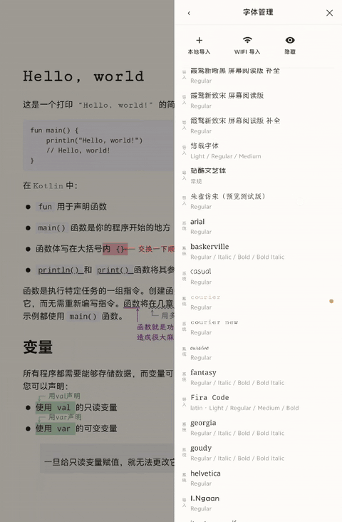

#  Orilumn

**Orilumn** 是跨平台 EPUB 阅读器，支持 EPUB 2 和 EPUB 3 标准。Orilumn 是基于 Kotlin KMP/CMP 技术，全程使用 AI 编写的。作者本人没有写代码，但对应用经过长时间的调试和打磨，也是作者目前唯一在平板上使用的 EPUB 阅读器。从目前来看，项目 BUG 应该不多，稳定性在一定程度上是有保证的。

## 为什么重写 EPUB 阅读器

在已经有这么多 EPUB 阅读器应用的情况下，为什么还要重新写新应用？是因为现有阅读器有总总不足：

- 基于自研排版引擎的阅读器对 EPUB 和 HTML5/CSS3 规范支持度不足，排版样式有很多阅读器个性化内容，不一定满足强迫症患者（例如本人😄）的需求。
- 基于 Webview 的阅读器只能支持分页横向滑动，性能不足以平滑支持 3D 卷曲翻页和全书预排版，还有很多其他方面的限制。
- 现有断行引擎对于中英文混排书籍的两端对齐支持不佳，URL/程序代码等长字符串内部不断行，所以少数汉字和长字符串之间一定会断行，又为了对齐强行拉大汉字间距，版式不美观。
- 多数阅读器不支持 $\LaTeX$ 公式。
- 几乎所有阅读器都只能读，不能改，看到书中有错误也只能听之任之；或先做笔记，事后在编辑软件上逐一搜索修改，过程麻烦。
- 排版样式可定制度不高，无法基于不同的书籍及内容逐项定制。
- 中英文混排字距基本未作处理，完全依赖原书是否在中英文字符之间添加空格。
- 不支持多字重字体的字重选择。
- 无法同步在书页上显示读者批注，只能通过点击对应的批注标记，再弹窗显示批注内容，与纸质书籍的批注和阅读体验有较大落差。
- 部分应用界面、功能简陋，美观度不足，或对中文支持不佳。

## Orilumn 的特点

Orilumn 阅读器就是为了解决以上种种问题而开发的。之前，为了支持完整的 CSS 特性，选用了基于 Webview 的方案，但后来发现，Webview 方案性能不佳，限制很多，无法满足要求。因此，最终采用基于 Kotlin KMP/CMP 的自研浏览器引擎方案，以便尽可能完整地支持所有 EPUB 标准所要求的 HTML/CSS 特性。

到目前为止，Orilumn 已经支持很多新 EPUB 阅读器特性，而且还在不断开发新特性。已经或基本支持的特性包括：

- 支持跨平台，已支持的平台包括安卓平板、Windows、macOS、Linux。
- 采用自研浏览器引擎，支持 EPUB 2/3 规范所要求的所有 HTML/CSS 特性。
- 采用自研断行引擎，支持 URL/标识符长字符串的内部断行，例如在 `-`、`_`、`.`、`/` 等字符处，以及驼峰式标识符的单词之间断行。
- 支持字间距分类、分级压缩和拉伸，段落两端对齐排版效果整齐美观。
- 采用可调节的中英文混排字距，完全替换书内中英文字符间空格，无论原书是否有空格，读者都可以获得一致的观感。
- 支持原书、传统（用中文首行缩进区分段落）、现代（无首行缩进，用段间距区分段落）三个排版主题；在原书模式下，尽可能尊重原书样式表，不强制添加阅读阅读样式。
- 读者可以通过参数面板、自定义样式（待开发）等方式覆盖原书样式设置。
- 批注是读者高亮和下划线笔记的附属品，而不是独立的笔记功能。因此无论高亮还是下划线，读者都可以自主决定是否添加文字批注；已有批注可以点击修改。
- 优化的批注排版引擎，支持在字里行间选择最近的空白处放置、折行或折叠显示批注文字，观感一目了然；或在空间不足时自动折叠、省略、或塌缩为标记符号，读者可以点击显示；读者也可以选择像其他应用一样，只显示批注符号，以改善排版性能。
- 支持外挂式内容修订功能，自动将选区内容转换为 Markdown，在 Markdown 输入区进行内容编辑，甚至可以使用 HTML 标记；修改完成后将 Markdown 反向转换为 EPUB 书籍的 HTML 格式。
- 支持审阅模式和阅读模式切换，在审阅模式下，所有修订内容一目了然。
- 支持本地目录导入和通过 wifi 方式导入字体。
- 同一字体的不同字重文件，在列表中自动组合为同一个列表项；用户可以通过左滑动画拉出删除按钮来删除整个字族。
- 笔记、书签、修订、字体等所有列表均支持统一的左滑拉出删除按钮功能。
- 同时支持系统字体和用户导入字体；为了简化列表显示，字体列表中隐藏了所有非 CJK 和拉丁语字体（图形符号除外）；用户也可以左滑拉出“隐藏”按钮，隐藏其他不需要的系统字体。
- 优化的滑动翻页动画，以及模拟真实书籍的 3D 卷曲翻页动画设计，兼顾性能和平滑度，阴影效果自然。
- 优化的高性能多线程排版引擎，采用快速和持久化两套分页表，允许读者快速进入阅读，快速在书内跳转（通过目录、链接、笔记、修订、书签、进度条等等），以及随排版参数调整实时更新页面显示。
- 后台线程管理引擎，统一按预定优先级调度、管理后台任务。
- 根据排版结果，自动生成页码和进度条，或在全书排版未完成时，自动塌缩为以章为单位的百分比进度。

## 演示

| 3D 卷曲翻页 | 卷曲翻页细节 |
|:---:|:---:|
|  |  |

| 批注字号调整 | 批注折叠开关 |
|:---:|:---:|
|  |  |

| 修改批注样式 | 添加和删除书签 |
|:---:|:---:|
|  |  |

| 修改 EPUB 内容 | 修订和选区调整 |
|:---:|:---:|
|  |  |

| 字体列表动画 | 笔记列表动画 |
|:---:|:---:|
|  |  |

## 支持的平台和构建产物

官方产物在 [Releases](https://github.com/orilumn/orilumn/releases) 里，由 `vX.Y.Z` tag 触发 GitHub Actions 构建。由于时间和设备有限，不会每次构建都一一测试，所以不保证每个平台工作都正常，但平板是我主要的测试和使用平台，应该相对稳定。

| 平台 | 构建文件 | 实测 | 下载 |
|---|---|---|---|
| Android 7.0+ 平板 | `orilumn-<版本>-android.apk` | ✅ 实测 | [点此下载](https://github.com/orilumn/orilumn/releases/latest/download/orilumn-0.5.10-android.apk) |
| macOS Intel | `Orilumn-<版本>-macos-x64.dmg` | ✅ 实测 | [点此下载](https://github.com/orilumn/orilumn/releases/latest/download/Orilumn-0.5.10-macos-x64.dmg) |
| Linux · Ubuntu | `Orilumn-<版本>-linux-x64.deb` | ✅ 实测 | [点此下载](https://github.com/orilumn/orilumn/releases/latest/download/Orilumn-0.5.10-linux-x64.deb) |
| Linux · EndeavourOS | `Orilumn-<版本>-linux-x64.AppImage` | ✅ 实测 | [点此下载](https://github.com/orilumn/orilumn/releases/latest/download/Orilumn-0.5.10-linux-x64.AppImage) |
| Windows | `Orilumn-<版本>-windows-x64.msi` | ✅ 实测 | [点此下载](https://github.com/orilumn/orilumn/releases/latest/download/Orilumn-0.5.10-windows-x64.msi) |
| macOS Apple Silicon | `Orilumn-<版本>-macos-arm64.dmg` | ⚠️ 未实测 | [点此下载](https://github.com/orilumn/orilumn/releases/latest/download/Orilumn-0.5.10-macos-arm64.dmg) |
| 其他 Linux 发行版 / 桌面环境 | `Orilumn-<版本>-linux-x64.AppImage` | ⚠️ 未实测 | [点此下载](https://github.com/orilumn/orilumn/releases/latest/download/Orilumn-0.5.10-linux-x64.AppImage) |

> ###### 备注
> “支持”= 能构建出该平台产物；“实测”= 本项目作者真正在对应平台上跑过。其余组合可以跑，但没有验证过，不保证可用。因为作者没有实机，新版 macOS 的触屏功能暂不支持。
>
> Linux 除上表列出的首选产物外，另有 `.rpm`（给 Fedora / openSUSE 一类发行版）；`.AppImage` 是通用便携格式，任何发行版解压即跑。所有文件都在同一次发布里。

## 后续开发计划

- 增加页内分栏显示功能，并允许读者调节栏数和栏间距；
- 支持相邻中文标点空白压缩；
- 增加书架封面尺寸调节功能，允许读者通过滑块调节封面尺寸；
- 完善阅读主题的定制和删除功能；
- 完善现代和传统两套排版主题（因书籍格式多样，规范化程度不一，这是个长期任务）；
- 增加基于读者选择内容提供候选 CSS 选择器，并在此基础上进行样式定制，以及定制样式的列表显示和编辑功能；
- 增加点击图片时显示全屏图片浏览窗口，并支持手势缩放和拖拽滚动浏览；
- 增加 nowrap 代码块浏览功能，并支持横向滚动；
- 视情况增加代码高亮显示功能；
- 增加全局查找、替换功能；
- 增加字典/翻译功能；
- 支持弹窗式脚注显示；
- 增加 wifi 导入书籍功能；
- 增加 $\LaTeX$ 支持；
- 增加五线谱支持（需调研可行性）；
- 支持 SVG；
- 安卓手机屏幕个性化调整；
- 后台任务调度视实际情况提升到应用级；
- 增加 OPDS 书库支持；
- 书架分组管理；
- 增加中文竖排排版主题；
- 增加中文简繁互转；
- 增加国际化支持；
- 增加修改后的 EPUB 文件导出；
- 支持其他格式的电子书，或 txt 小说阅读（需调研可行性）；
- 笔记、书签、修订、设置、阅读进度等跨平台同步（需要服务器支持）。

## License

- Orilumn 代码采用 **MIT License**，见 [LICENSE](LICENSE)。
- 第三方组件各自保留其许可证。
